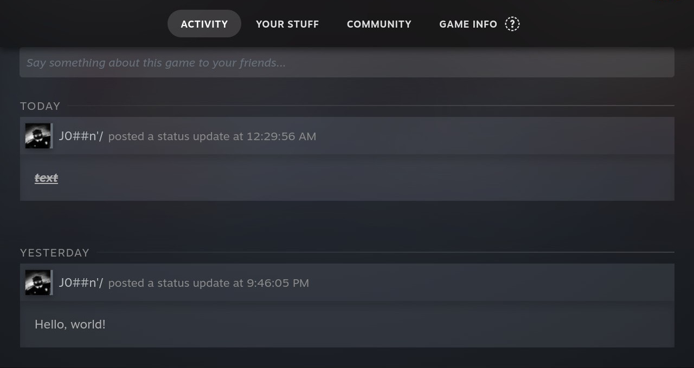
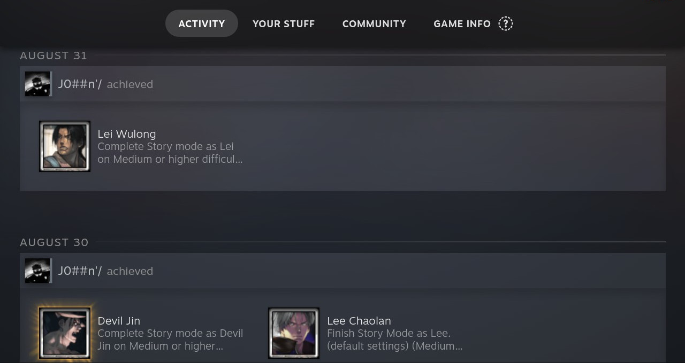
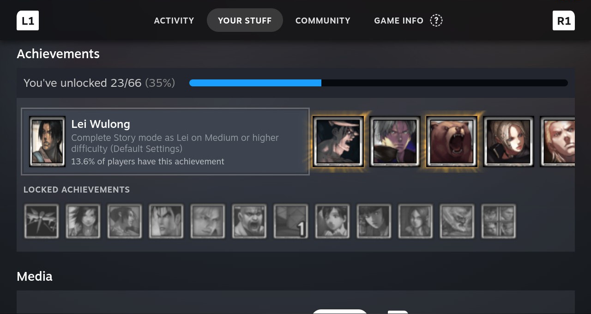
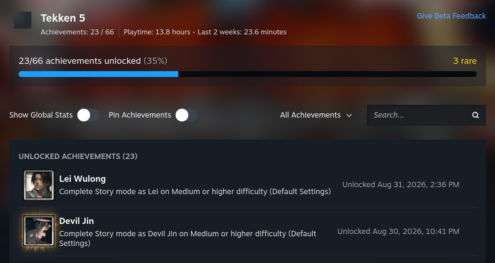
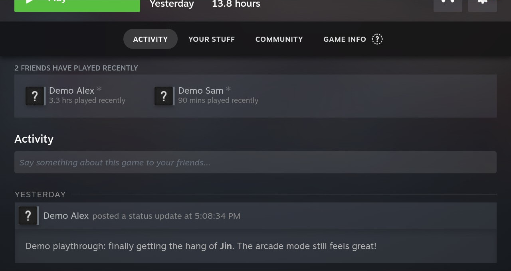

# Activity

[](LICENSE)
[](https://ko-fi.com/ynhhoj)

Activity is a [Decky Loader](https://github.com/SteamDeckHomebrew/decky-loader) plugin that brings game activity to non-Steam games on Steam Deck. It connects supported games to the [Activity service](https://activity.o3h3.com) and integrates their activity into Steam's game interface.

TLDR: Social features for emulated of a simple Steam game now is supported for non-steam games too! 

## Features

- Recognize supported non-Steam games through local game-image identification and the Activity catalog.
- View game activity and friends' gameplay, and post or delete your own Activity comments.
- Record play sessions for recognized game releases.
- Display RetroAchievementts.
- Sign in through a QR code or device code.

Currently are supported only: **PlayStation, PlayStation 2, and PSP** games.

## Showcase

|  |  |
| --- | --- |
| <br>Share your thoughts with your friends directly from Steam UI. | <br>Also you can watch your earned achievements dirrectly in **Activity** feed! Crazy... |
| <br>Achievements are now back again in **Your stuff** tab. A forgotten technology since *Emuchievements* disappearead (**R.I.P**) :( ...... **now is BACK!** | <br>Detailed view of your achievements! |
| <br>View your friends comments and see how much time they played! Just like in official Steam games! | soon™ |

## Installation

[Decky Loader](https://github.com/SteamDeckHomebrew/decky-loader) must be installed first.

Install an `Activity.zip` release package through Decky Loader's manual ZIP installation option. To produce the package yourself, follow [Building an installable package](#building-an-installable-package).

## Usage

1. Open Decky Loader in the Quick Access Menu and select **Activity**.
2. Select **Sign in**. Scan the QR code with your phone, or open the displayed URL on another device and enter the device code.
3. Approve the Deck using your Activity account.
4. Open a supported non-Steam game's page to use the integrated activity features.

Use an Activity account linked to the current Steam user to post comments. RetroAchievements progress requires RetroAchievements credentials in the Activity session.

The plugin settings show account status and game-detection availability. Enable **Advanced → Debug logging** when collecting logs for a bug report. If disc detection is unavailable, RetroAchievements progress for supported disc images cannot load; check that the installed package includes the native `game-anatomy` extension.

## Development requirements

| Tool | Version / purpose |
| --- | --- |
| Node.js | 24, as used in CI |
| pnpm | 12.5.1, as used in CI |
| Python | 3.11 or newer; CI tests 3.11 and 3.14 |
| [uv](https://docs.astral.sh/uv/) | Python environment and dependency management; CI uses 0.12.5 |
| Git | Submodule checkout for `game-anatomy` |
| [Decky CLI](https://github.com/SteamDeckHomebrew/cli) | Installable package builds; CI uses 0.0.8 |
| Docker | Containerized native backend build |
| Rust and Make | Only needed on the host when building the native extension outside the container; Rust must support edition 2024 |

## Local setup

Run these commands from the repository root:

```sh
git submodule update --init --recursive
pnpm install --frozen-lockfile
uv sync --locked
```

The submodule URL uses SSH (`git@github.com:o3h3-activity/game-anatomy.git`). Ensure your GitHub SSH access is configured. The package-build workflow also supports HTTPS checkout and a `GAME_ANATOMY_READ_TOKEN` secret for repositories requiring authentication.

### Frontend build

```sh
pnpm run build
```

This builds the frontend entry point, `src/index.tsx`, into `dist/index.js` with source maps. It does **not** build the native extension or create an installable plugin ZIP.

To rebuild the frontend when source files change:

```sh
pnpm run watch
```

This is a build watcher, not automatic deployment to the Deck.

### Building an installable package

With Decky CLI on your `PATH`, Docker available, and the submodule initialized:

```sh
decky plugin build . --output-path out
```

This is the package-build command used in CI. The output is `out/Activity.zip`. The native build is configured by `backend/Dockerfile`, `backend/entrypoint.sh`, and `backend/Makefile`; it produces `game_anatomy.abi3.so` and includes the submodule's license as `game-anatomy.LICENSE` in the package's `bin/` directory.

For a host-only native build on x86-64 Linux:

```sh
make -C backend
```

This writes the extension to `backend/out/`; it does not package or install the plugin. The backend loads the extension from the installed plugin's `bin/` directory.

## Checks

Run from the repository root after installing the development dependencies:

| Command | Purpose |
| --- | --- |
| `pnpm run lint` | Frontend and Python linting |
| `pnpm run lint:frontend` | Biome, Oxlint, and ESLint frontend checks |
| `pnpm run lint:python` | Ruff lint checks |
| `pnpm run format:python:check` | Python formatting check |
| `pnpm run typecheck:python` | Strict Python type checking with BasedPyright |
| `pnpm run check:python` | Python lint, formatting, type checks, and tests |
| `pnpm run test` | Frontend and backend tests |
| `pnpm run test:frontend` | Vitest frontend tests |
| `pnpm run test:python` | Python `unittest` discovery in `tests/` |
| `pnpm run lint:fix` | Apply frontend lint/format fixes and Python lint/format fixes |

Python scripts invoke `uv run --locked`. CI runs frontend checks, Python checks, and a separate Decky package build with a packaged native-extension smoke test. Tags beginning with `v` trigger release publication after those jobs succeed.

## Acknowledgements and license

Built on [Decky Loader](https://github.com/SteamDeckHomebrew/decky-loader) and the [Decky plugin template](https://github.com/SteamDeckHomebrew/decky-plugin-template), with achievement data from [RetroAchievements](https://retroachievements.org/) and local game-image identification from `game-anatomy`.

The plugin's license is [BSD 3-Clause](LICENSE). The `game-anatomy` submodule has its own [license](game-anatomy/LICENSE), which is included in installable packages.
